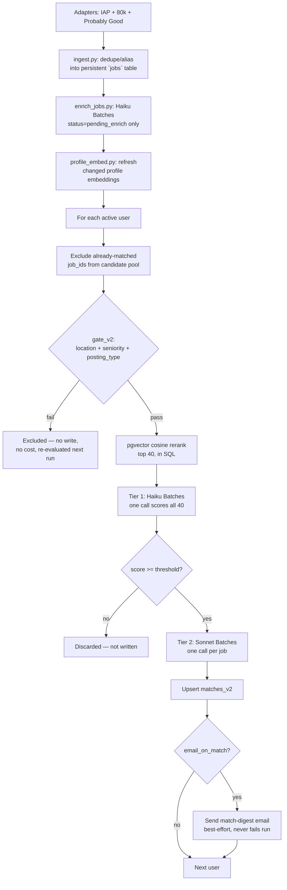

# True North (job_evaluator)

Daily, serverless, **multi-user** pipeline that ingests EA-aligned job boards into a **persistent** Supabase `jobs` table, enriches each posting once with structured LLM output (seniority, cause area, work arrangement, posting type), and matches that shared pool against every registered user's own profile embedding and hard constraints — writing high-fit roles into a Supabase `matches_v2` table per user with LLM-generated reasoning. It runs on a schedule via GitHub Actions and requires no infrastructure beyond a repo, a Supabase project, and a handful of API keys.

**This is v2.** The pipeline was rebuilt this way to make the job pool persistent (postings are ingested once and re-enriched only when their content actually changes, rather than re-scraped and re-scored from scratch every day) and to add semantic matching (a vector-embedding rerank on top of the hard gate) alongside the existing rubric-style scoring. v1 — the original scrape-fresh-every-day, weighted-dimension-scoring pipeline — is disabled in the daily cron (`.github/workflows/daily.yml`'s v1 step is `if: false`) but its code, tables, and scrapers are untouched; see [Legacy: v1](#legacy-v1) for what's still there and how to roll back.

## What it does

Every morning the pipeline pulls postings from three EA job boards, dedupes/aliases them into a persistent `jobs` table (a posting already ingested with unchanged content costs nothing further; a posting whose content changed gets re-enriched), and enriches anything new or changed with structured LLM output. Then, for every user with a Supabase profile: it excludes jobs that user has already been matched to, runs a hard gate (location + seniority + posting-type), reranks the survivors by cosine similarity between the job's embedding and the user's profile embedding, scores the top 40 with a cheap holistic LLM pass, generates full CV-guidance enrichment for anything that clears a threshold, and — if that user has opted in — sends them a digest email for the matches found this run.



## Sources

**Three boards, reused unchanged from v1.** `src/adapters/` wraps each v1 source module's existing network-fetch code (`src/sources/eightyk.py`, `probablygood.py`, `iap.py`) unmodified — only the parse step is new, producing `JobPosting` (v2's shape) instead of v1's `RawPosting` from the same raw API responses. IAP referral opportunities live in a public Google Sheet (Sheets API + service account); 80,000 Hours and Probably Good are both Algolia-backed (Probably Good's search key is short-lived and fetched at runtime via GraphQL). Each adapter is wrapped in its own try/except in `pipeline_v2.py` so one board failing degrades the run to the others rather than aborting it.

## The persistent jobs pool

**Unlike v1's scrape-fresh-every-day model, v2's `jobs` table persists across runs.** `ingest.py` dedupes incoming postings against it by canonical URL (same URL, unchanged content → just touch `last_seen`; same URL, changed content → update and reset to `status='pending_enrich'` for re-enrichment) and by fuzzy `(org, title)` match (a re-post under a different URL → a `job_aliases` row pointing at the existing job, not a duplicate). `enrich_jobs.py` only ever processes `status='pending_enrich'` rows — new or genuinely content-changed postings — so steady-state enrichment cost stays small regardless of how large the historical pool grows. Both `jobs.embedding` (title+summary, Voyage) and `jobs.enrichment` (structured JobEnrichment jsonb) are computed once per posting and reused by every user's matching pass, not recomputed per user.

There is currently no staleness/archival concept for `jobs` — the table only grows. Not a problem at today's scale, but worth knowing if the pool grows into the tens of thousands of rows.

## Multi-user model

**Unchanged from v1, reused as-is.** `profiles` and `scoring_weights` still hold identity/preferences and gate config exactly as before (`src/user_store.fetch_users()` is imported unmodified). v2 adds one thing: `profiles.profile_embedding` (Voyage, 1024-dim) and `profiles.profile_content_hash` (only re-embedded when the rendered text actually changes). The embedding text is built from `career_goals`, `cause_priorities`, `experience_inventory`, `skills`, and `values_notes` — deliberately **not** `location`/`comp_needs`, which `gate_v2` already enforces as hard constraints; including them in the embedding would just be redundant noise against semantic-similarity signal, not additional signal.

A user is skipped (logged, not fatal) if their rendered profile text is empty or their `profile_embedding` hasn't been computed yet — both are treated as "incomplete profile," the same bias-toward-graceful-skip philosophy v1 already had for missing `scoring_weights`.

## Matching model: hard gate → vector rerank → two-tier LLM scoring

**`gate_v2.py` runs first, same binary philosophy as v1's gate** (bias toward false positives; an unstated field or unrecognized value passes) but evaluated against a job's *structured* enrichment rather than raw text. Location checks `work_arrangement.mode`/`remote_scope`/`eligible_regions` for remote roles (falling back to `location_field` raw-text region matching for hybrid/onsite, since enrichment doesn't carry a structured office-location field) — this is strictly more accurate than v1's bare keyword match, which can't distinguish "Remote" from "Remote, US-authorized-only." Seniority reads pre-classified buckets from `enrichment.seniority` instead of re-deriving them from text. A third check, `posting_type`, excludes `volunteer`/`funding` postings by default (a `null` value, from rows enriched before this field existed, is treated as `job` — not excluded).

**Gate survivors are excluded from a user's already-matched jobs first**, then reranked by pgvector cosine similarity between the job's embedding and the user's profile embedding — entirely in SQL via the `match_v2_top_jobs()` Postgres function, not computed in Python — capped at the top 40. Without the already-matched exclusion, a user's existing strong matches would keep winning top-40 slots indefinitely, permanently starving new jobs from ever reaching Tier 1.

**Tier 1** is one Haiku Batches API call per user, scoring all 40 job cards 0–100 in a single prompt (not 40 separate calls) — the user's gate constraints are included as context only, with an explicit instruction *not* to re-apply them, just to weigh soft friction the binary gate can't see (e.g. a hybrid role implying more office days than the location match alone suggests). **Tier 2** is one Sonnet Batches call per (user, job) pair scoring ≥65, generating the same org summary / why-fits / why-not-fits / CV-emphasis output shape v1's Tier 2 always produced — reused exactly, not reinvented, so the frontend's existing renderer needs no changes.

## Crash-safe LLM batches

**The Anthropic Message Batches API is asynchronous by nature — submit, poll, retrieve — and each of those three steps can fail independently.** This pipeline lost real money to exactly that once: a batch's output was successfully retrieved (paid for) and then lost entirely when the subsequent database write crashed, because nothing had been persisted in between. The fix, applied identically across `enrich_jobs.py`/`tier1_rerank.py`/`tier2_enrich.py`:

- **`batch_submissions`** tracks each batch's own lifecycle (`submitted` → `retrieved`). Before submitting new work, each module checks for an outstanding `submitted`-but-not-`retrieved` batch for itself and resumes polling it instead — so a run that dies mid-poll (a real risk: batches can legitimately take up to 24h) doesn't duplicate an already-paid-for submission on the next run.
- **`batch_results`** stores every raw result immediately on retrieval, one row per `(batch_id, custom_id)`, *before* any parsing or validation risk.
- **`run_metrics`** is written right after usage is tallied — before the final table write — so a crash in that write no longer loses the cost record, only requires the write itself to be retried.
- **`reprocess_staged(client, batch_id)`** (one per module) replays unprocessed staged results without calling the API again.

## Output: `matches_v2`, upsert-only, never touching user-owned columns

Same invariant as v1's `matches` table, structurally enforced rather than just disciplined: `tier2_enrich.py`'s upsert payload (`user_id, job_id, tier1_score, tier2, created_at`, keyed on `(user_id, job_id)`) has no `status`/`user_notes`/`discarded` fields at all. In practice a `(user_id, job_id)` pair is never re-processed after its first match anyway, because the already-matched skip-set filters it out before gating even runs.

## Match-digest email

**Reused completely unchanged from v1** — same `src/notify.py`, same `MATCH_DIGEST_URL`/`PIPELINE_SHARED_SECRET` Edge Function contract, same never-raise best-effort guarantee, same second-layer try/except at the call site. v2 only had to map its own data into v1's existing payload shape (`{title, org, location, fit_score, why_fits, url}` — `location` comes from `jobs.location_field`, `fit_score` from the Tier 1 score, `why_fits` from the Tier 2 output's `why_fits`).

⚠️ **Known issue, confirmed pre-existing:** the digest endpoint is currently returning `401 Unauthorized` in production. This predates the v2 cutover — v1's own last scheduled run before this rebuild hit the identical error on the identical endpoint — so it's not something this pipeline's code introduced, but no digest email is currently being delivered by either version. Needs the Edge Function or `PIPELINE_SHARED_SECRET` checked outside this repo.

## Deployment

**GitHub Actions on a daily cron**, same schedule as before (06:00 UTC). `workflow_dispatch` accepts `dry_run` and `only_user_id` (the same inputs v1 used — `limit` is v1-only now, v2 has no equivalent since its steady-state ingest volume is small by design). The job's `timeout-minutes` is 350 (up from v1's 20) — v2 chains up to three sequential Batches API polls per run, each already polling internally for up to an hour, so a realistic budget is much larger even though most runs finish in well under that.

**`only_user_id` is the cost-capped manual-trigger path**: no scraping, no job enrichment, no job embedding — just that one user's profile-embedding refresh (free if unchanged) and the matching pass against the already-enriched pool. Confirmed in production: ~$0.03–0.05/run vs. a full scheduled run's ~$0.90+. Same `search_quota` running/complete/failed bookkeeping as v1's one-off path, reused unchanged.

Concurrency is `cancel-in-progress: false` — a second trigger queues behind the first rather than cancelling it, which also means two `--only-user-id` runs (or one full run and one single-user run) never actually execute concurrently against the same batch-submission tracking.

## Repository layout

```
src/
  adapters/                        SourceAdapter wrappers around v1's unchanged fetch code
    base.py, eighty_thousand_hours.py, probably_good.py, iap.py
  models/
    job_enrichment.py              JobEnrichment/WorkArrangement/SalaryRange (strict, incl. posting_type)
    tier1_rerank.py                JobScore/Tier1RerankOutput (strict)
  ingest.py                        Dedupe/alias into the persistent `jobs`/`job_aliases` tables
  enrich_jobs.py                   Haiku Batches enrichment + Voyage embedding; reprocess_staged() recovery
  profile_embed.py                 Profile embedding, re-embed-on-change
  gate_v2.py                       Hard-constraint gate on structured enrichment (location/seniority/posting_type)
  match_v2.py                      gate_v2 survivors -> pgvector cosine rerank (top 40, in SQL); already-matched skip-set
  tier1_rerank.py                  One Haiku Batches call per user, all top-40 cards in one prompt
  tier2_enrich.py                  One Sonnet Batches call per (user,job) pair >= threshold; matches_v2 write
  pipeline_v2.py                   Orchestration: scheduled full mode + manual DB-only mode
  supabase_client.py               get_client(), fetch_all() (pagination), chunked_upsert/insert, batch lifecycle
  notify.py, quota_store.py, user_store.py    REUSED UNCHANGED from v1
  sources/                         REUSED UNCHANGED from v1 — iap.py, eightyk.py, probablygood.py
  # v1 (disabled in the cron, still present) — pipeline.py, gate.py, scoring.py, enrich.py,
  # matches_store.py, seen_store.py, run_store.py, schemas.py
supabase/migrations/                SQL applied by hand via the dashboard (no Supabase CLI in this workflow)
tests/                              Unit tests, incl. FakeSupabaseClient + fake Anthropic Batches clients
.github/workflows/daily.yml         v1 step: if: false. v2 step: active.
```

## Configuration

Same required values as v1 (Anthropic key, Supabase URL + service-role key, Algolia app ID/key/index, IAP sheet ID/tab, Google service-account JSON), plus `VOYAGE_API_KEY` for job/profile embeddings (voyage-3.5, 1024 dims — no `voyageai` package; embedding calls go straight to Voyage's REST API via `httpx`, same "don't add a dependency for a step that might be unset" philosophy the rest of this pipeline follows). `MATCH_DIGEST_URL`/`PIPELINE_SHARED_SECRET` degrade gracefully when unset, same as v1. See `.env.example` for the full list.

## Known limitations

**No staleness/archival for the persistent `jobs` table.** Every ingested posting stays in the pool indefinitely; there's no v1-style 14-day cutoff equivalent. Not a problem at today's scale (under 2000 rows), but the gate-survivor set and the vector-rerank candidate array will keep growing as the pool grows.

**The digest email is currently broken** (401 Unauthorized) — see "Match-digest email" above. Pre-existing, not caused by this pipeline.

**Source retrieval is still capped at the most recent ~1000 postings per Algolia-backed board** — unchanged from v1, same underlying Algolia search-tier limit (see v1's own note below).

**`posting_type` was only backfilled for rows whose title matched an obvious non-job signal** (volunteer/grant/fund/speculative/open application) at the time it was added — older 80k rows enriched before that field existed have `posting_type=null`, treated as `job` by `gate_v2`, not re-enriched retroactively.

## Legacy: v1

`src/pipeline.py`'s scrape-fresh-every-day, seven-dimension weighted-sum scoring model is fully intact and tested, just not invoked by the cron (`.github/workflows/daily.yml`'s "Run pipeline" step has `if: false`). It wrote to `matches`/`seen`/`pipeline_runs`/`pipeline_run_users` — none of which any v2 module reads or writes. To roll back: remove `if: false` from v1's step in `daily.yml` and add it to v2's "Run pipeline v2" step instead — a one-line change each way, no data migration needed since the two pipelines never shared write targets.

v1's own documented characteristics (still true of that code, for historical/rollback reference): per-user hard gate with `rejection_reason` diagnostics; two-tier Haiku/Sonnet scoring with concurrent, batched Tier 1 calls (`TIER1_BATCH_SIZE`); a per-user `seen` cache with a 14-day staleness cutoff for postings with no natural recency signal; best-effort run-history telemetry (`pipeline_runs`/`pipeline_run_users`) with a `complete_partial` degraded-write path.

## Testing

`python -m pytest tests/` — 812 tests, all against a lightweight in-memory `FakeSupabaseClient` (no real network or database) plus fake Anthropic Batches clients for the three LLM-call modules. Coverage includes: `gate_v2` (location/seniority/posting_type, rejection-reason categorisation), `match_v2` (gate filtering, vector-rerank RPC wiring, already-matched exclusion), the crash-safe batch lifecycle (submission tracking, resumption, staging, `reprocess_staged` recovery, dict-based parsing shared between live and replay paths), `fetch_all`/`chunked_upsert`/`chunked_insert`, `pipeline_v2.py`'s scheduled-vs-manual wiring and digest-payload mapping, plus everything still covering v1's untouched logic (hard gate, dimension weighting, seen-cache batching, matches upsert allowlist, run-history telemetry).
